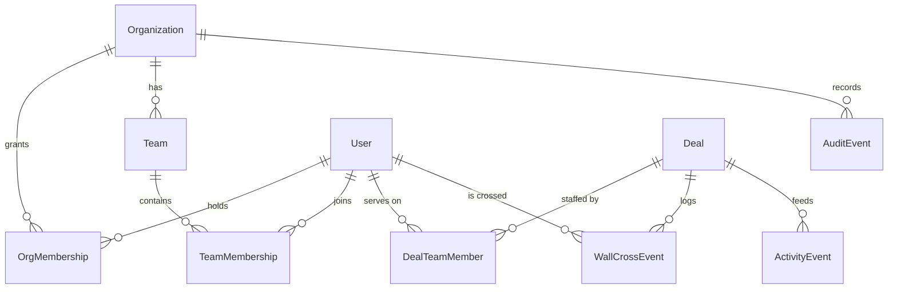
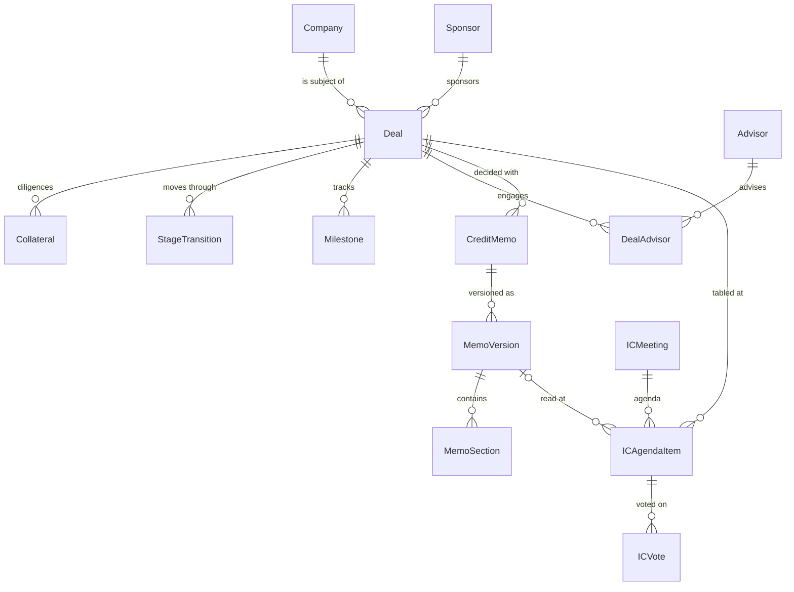
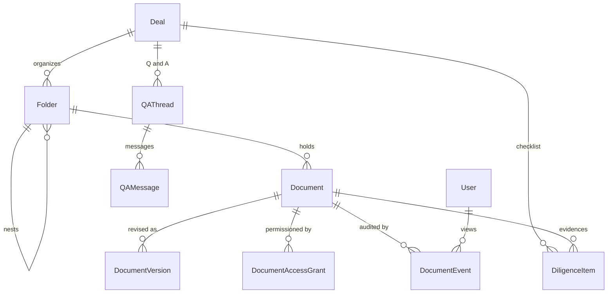
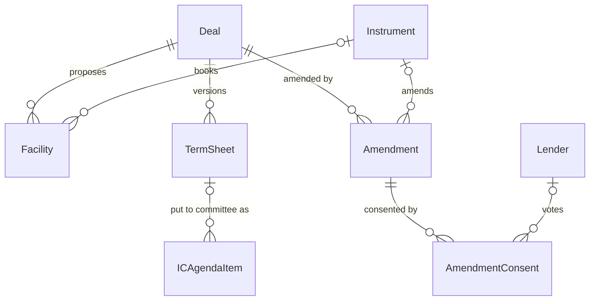
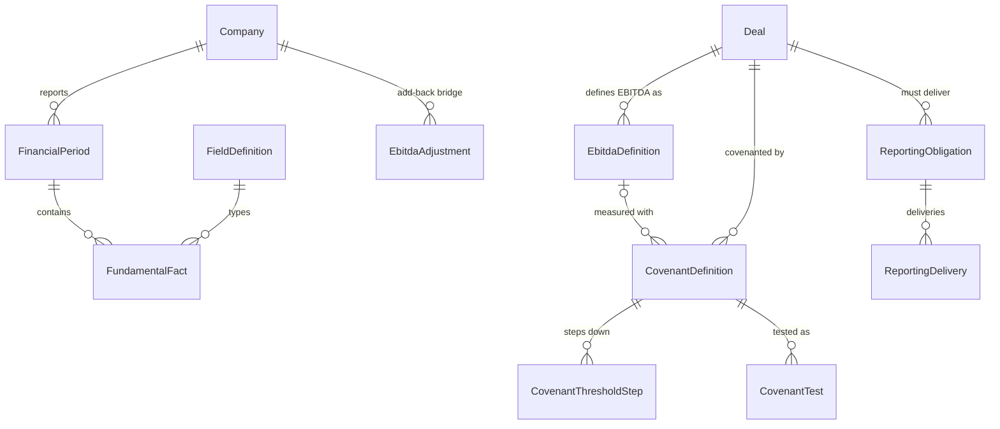
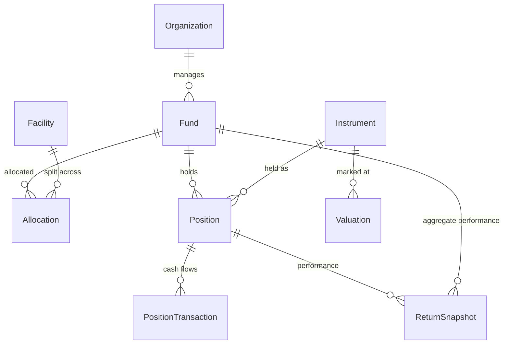
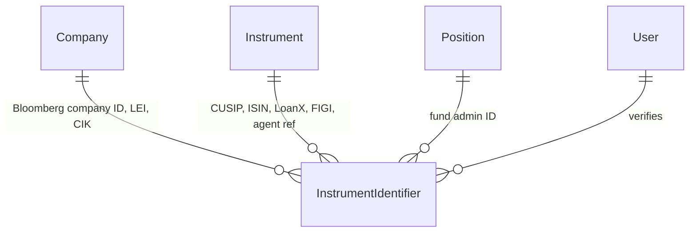

# Canonical Data Model — Private Credit Deal Room & Dashboard

A clean-slate reference model for a deal room and its dashboard, designed as an
**overlay**. It owns the workflow and the state that cuts across systems:
**pipeline**, **team & access**, **data room**, **committee decisions**,
**covenant monitoring**, **fund positions**, **alerts**, and the **history**
dashboards trend. Everything another system is the source of record for —
**borrowers, sponsors, advisors and lenders** (entity master), **instruments
and their loan terms** (security master), **collateral** (collateral system)
and **market data** (the vendor) — it holds only as a link, and reads from the
source. See [the boundary](#the-boundary-what-this-model-owns-and-what-it-links-to).

- **Schema:** [`schema.canonical.prisma`](./schema.canonical.prisma) — 62 models, 38 enums, validated.
- **XSD view:** [`schema.canonical.xsd`](./schema.canonical.xsd) — the same model as XML Schema,
  generated from the Prisma file. Often the faster read: types, enums and foreign keys are all
  spelled out in one place. See [§8](#8-xsd-view).
- **Interactive explorer:** [`explorer.html`](./explorer.html) — click any entity to see what it
  references and what references it, then dive through the graph. See [§9](#9-interactive-explorer).
- **Target:** PostgreSQL (native enums, `Decimal` money, composite indexes, `String[]`, `Json`).
- **Status:** design artifact. It is deliberately *separate* from the running app schema
  (`prisma/schema.prisma`) and generates to its own client output, so it cannot clobber
  the live client. Nothing in the running app changes.

```bash
CANONICAL_DATABASE_URL="postgresql://u:p@localhost:5432/canonical" \
  npx prisma validate --schema=docs/data-model/schema.canonical.prisma
```

---

## Table of contents
1. [Design principles](#1-design-principles)
2. [Domain map](#2-domain-map)
3. [Entity–relationship diagrams](#3-entityrelationship-diagrams)
4. [Entity catalog](#4-entity-catalog)
5. [Dashboard completeness matrix](#5-dashboard-completeness-matrix)
6. [What this changes vs. the current schema](#6-what-this-changes-vs-the-current-schema)
7. [Adoption path](#7-adoption-path)
8. [XSD view](#8-xsd-view)
9. [Interactive explorer](#9-interactive-explorer)

---

## 1. Design principles

### The boundary: what this model owns, and what it links to

The deal room is the source of record for its own workflow and for state that
spans systems. For everything else it holds a link and reads the source.

| Area | Owned here | Linked — read from the system of record |
|---|---|---|
| Counterparties | which sponsor and advisors are on a deal, and the advisor's mandate | `Company`, `Sponsor`, `Advisor`, `Lender` → **entity master**: names, industry, ownership, legal-entity structure, fiscal calendar |
| The financing | the tranches a deal proposes (`Facility`), the term-sheet versions put to committee (`TermSheet`), the amendment and consent workflow | `Instrument` → **security master**: every booked term — pricing, rate index and fixings, maturity, amortisation, call protection, fees, the lender register, the cash-flow schedule |
| Collateral | which collateral a deal's diligence and monitoring cover | `Collateral` → **collateral system**: what it is, what it is worth, what it secures |
| Credit monitoring | covenant definitions, tests, reconciliation, the add-back ledger, reporting deliveries, financial facts as received and reconciled, internal ratings, watchlist, alerts | — |
| Portfolio | funds, allocations, positions, marks, returns | positions point at `Instrument` |
| Market data | — | FX, reference rates, comps → **the vendor** (Bloomberg) |

A link row is deliberately bare: `id` (so local foreign keys work), `orgId`, and
`masterRef` — the record's ID in its system of record. No names, descriptions,
terms or values. Showing a borrower's name in a list is the integration layer's
job (a read-through cache), not something this model stores, so there is no
second copy to drift.

Three calls on the boundary are worth knowing, because each could reasonably go
the other way:

- **Covenant definitions stay here.** A credit agreement states the covenant
  levels, but encoding them as formulas, step-down schedules, tests and
  reconciliations is the monitoring workflow this model exists for. If your
  security master carries covenant levels, the threshold schedule can be read
  from it instead.
- **Financial facts stay here.** `FundamentalFact` and `EbitdaAdjustment` record
  what the borrower reported, what Bloomberg returned and what we overrode, at
  the time a test ran. That is the evidence behind each covenant result, not
  reference data about the borrower.
- **Positions and marks stay here.** They are our holdings and our valuation
  decisions. If a fund administrator is the accounting book of record for
  positions, `Position` becomes a link in the same way.

### Rules applied throughout

Eight rules drive most of the structural differences from a naive model.

| # | Principle | Why it matters |
|---|---|---|
| 1 | **Money is `Decimal(20,4)`, never `Float`** | Float silently loses pennies when summing a portfolio. Ratios use `Decimal(18,6)`, percentages `Decimal(9,4)`. |
| 2 | **Anything trended is an event table, not a mutable scalar** | A dashboard cannot chart what the database overwrites. Stage, rating, marks and document versions are all append-only histories. (Term history such as repricings is the security master's.) |
| 3 | **Every actor is a `User` FK** | Free-text `uploadedBy`/`assignee`/`actor` strings cannot be filtered, permissioned, or attributed. |
| 4 | **Multi-tenant by `orgId` on root aggregates** | Org scoping at the aggregate root keeps every dashboard query naturally partitioned. |
| 5 | **Amounts travel with a currency** | A single-currency assumption is unpickable later. FX rates are market data, read from the vendor at roll-up time. |
| 6 | **Real-world identifiers are effective-dated rows, never columns** | A tranche has no CUSIP at sourcing, gains one at close, and an amend-and-extend retires its LoanX ID. A nullable `cusip` column can represent none of that. See [`InstrumentIdentifier`](#37-identifiers--cross-references). |
| 7 | **Systems of record are linked, never copied** | A copy of a borrower's details or a loan's terms is stale the first time the source changes. A link cannot be. |
| 8 | **Calendar dates are `@db.Date`** | Period ends, as-of, due and effective dates are days, not instants. Stored as a timestamp at UTC midnight, 30 June reads as 29 June anywhere west of Greenwich. |

Two further choices are worth calling out:

- **Facts over columns.** `FinancialPeriod` holds period *metadata*; the values live in
  `FundamentalFact` keyed by a governed `FieldDefinition`. Tracking a new metric never
  requires a schema migration, and every field declares its `aggregation`
  (`FLOW` / `STOCK` / `DERIVED`) so LTM-vs-calendar roll-ups are computable rather than assumed.
- **`Position`, not `Deal`, is the unit of economics.** A deal is a transaction; a position
  is a fund's holding in a facility. Exposure, marks and returns roll up from positions,
  which is what makes multi-fund/SPV allocation representable at all.

---

## 2. Domain map

| # | Domain | Models | Entities |
|---|---|---:|---|
| 1 | Identity, access & audit | 9 | `Organization` `User` `OrgMembership` `Team` `TeamMembership` `DealTeamMember` `WallCrossEvent` `AuditEvent` `ActivityEvent` |
| 2 | Links to systems of record | 6 | `Company` `Sponsor` `Advisor` `Lender` `Instrument` `Collateral` |
| 3 | Deal, pipeline & committee | 13 | `Deal` `StageTransition` `Milestone` `DealAdvisor` `ICMeeting` `ICAgendaItem` `ICVote` `CreditMemo` `MemoVersion` `MemoSection` `Task` `Note` `Comment` |
| 4 | Data room & diligence | 8 | `Folder` `Document` `DocumentVersion` `DocumentAccessGrant` `DocumentEvent` `DiligenceItem` `QAThread` `QAMessage` |
| 5 | Tranches, term sheets & amendments | 4 | `Facility` `TermSheet` `Amendment` `AmendmentConsent` |
| 6 | Financials & covenants | 10 | `FieldDefinition` `FinancialPeriod` `FundamentalFact` `EbitdaAdjustment` `EbitdaDefinition` `CovenantDefinition` `CovenantThresholdStep` `CovenantTest` `ReportingObligation` `ReportingDelivery` |
| 7 | Funds, positions & returns | 6 | `Fund` `Allocation` `Position` `PositionTransaction` `Valuation` `ReturnSnapshot` |
| 8 | Risk, alerts & dashboard support | 5 | `RatingHistory` `WatchlistEvent` `KpiSnapshot` `Alert` `SavedView` |
| 9 | Identifiers & cross-references | 1 | `InstrumentIdentifier` |

---

## 3. Entity–relationship diagrams

Split by domain — one diagram for 62 models would be unreadable. Links (domain 2) are drawn
where they are used.

### 3.1 Identity, access & the information barrier



### 3.2 Links, pipeline & committee



### 3.3 Data room & diligence



### 3.4 Tranches, term sheets & amendments



A `Facility` is a tranche as this deal tracks it. While it is a proposal its terms
live in the deal's `TermSheet`; once booked it points at an `Instrument`, and the
terms are read from the security master. Committee decisions point at the
`TermSheet` version they approved, which is what makes "approved versus booked"
checkable once the terms live elsewhere.

### 3.5 Financials, facts & covenants



### 3.6 Funds, positions & returns



---

### 3.7 Identifiers & cross-references



A link's `masterRef` is how the deal room reaches its own system of record.
These identifiers are the other direction: how third-party data that has never
heard of our `masterRef` — a Bloomberg request, a Markit mark, an agent notice —
is matched to the right link. One table, one row per identifier, exactly one
target per row. What makes it
trustworthy is enforced in the migration rather than the Prisma schema, which
cannot express either rule:

- **`CHECK (num_nonnulls(companyId, instrumentId, positionId) = 1)`**,
  so an identifier always names exactly one thing.
- **Partial unique indexes over live rows (`WHERE validTo IS NULL`)**: a live
  `(scheme, namespace, value)` names one thing only, and a target holds one live
  value per scheme. Retired rows are exempt, so an amend-and-extend retires a
  LoanX ID without deleting the history marks were taken against.

`namespace` carries the issuer for schemes that are only unique inside one
system (the agent's facility reference, a WSO instance). It is
an empty string rather than NULL so it takes part in the uniqueness rule.

The running app already implements this for borrowers and facilities
(`prisma/migrations/20261102120000_instrument_identifiers`), including the
check-digit validation in `src/lib/identifiers` and the Bloomberg lookup that
resolves an issuer by identifier rather than by name.

## 4. Entity catalog

Selected entities where the modeling decision is non-obvious. (Names are self-explanatory
for the rest; the schema file carries inline commentary on every one.)

| Entity | Purpose | Notable fields / constraints |
|---|---|---|
| `WallCrossEvent` | Immutable record of crossing/de-crossing the information barrier | `crossed`, `subject`, `approver`, `reason`; `DealTeamMember.isWallCrossed` is the denormalized current state |
| `AuditEvent` | Append-only audit with before/after payloads | `action`, `entityType`, `entityId`, `before`/`after` `Json` |
| `Company` · `Sponsor` · `Advisor` · `Lender` · `Instrument` · `Collateral` | Links to the entity master, security master and collateral system | `id`, `orgId` (or `dealId` for collateral) and `masterRef` only; unique per org on `masterRef` |
| `StageTransition` | Every pipeline stage change | `fromStage`, `toStage`, `daysInPrior` denormalized for cheap velocity math |
| `CreditMemo` | The memo behind one credit decision | `purpose`: initial, add-on, amendment, annual review — a deal accumulates them |
| `MemoVersion` / `MemoSection` | Real memo version history | `@@unique([memoId, versionNo])`; `CreditMemo.currentVersionId` points at the live one |
| `ICVote` | One member's vote on one agenda item | `@@unique([agendaItemId, voterId])`, so a deal back at committee is voted on afresh and earlier votes stay on record |
| `DocumentVersion` | Real file versions | `checksum`, `storageKey`, `extractedText` (search + AI grounding) |
| `DocumentAccessGrant` | Deny-by-default access to a doc *or* folder, for a user *or* team | `canView`/`canDownload`, `expiresAt` |
| `DocumentEvent` | View/download/print audit trail | the record LPs and regulators ask for |
| `Facility` | A deal's tranche | `label` within the deal; `instrumentId` set once booked |
| `TermSheet` | Versioned structure and terms proposed for a deal | `terms` `Json` snapshot; `ICAgendaItem.termSheetId` records which version a committee approved |
| `AmendmentConsent` | A lender's consent vote | threshold and holdings at the record date come from the security master's lender register |
| `FieldDefinition` | Governed field vocabulary | `aggregation` (FLOW/STOCK/DERIVED), `bloombergMnemonic`, `deriveFormula` |
| `FundamentalFact` | Every financial value, by field & period | `@@unique([companyId, periodEnd, periodType, isActual, fieldCode, source])` — a quarter and the LTM to the same date are different facts; sources layer, overrides win |
| `EbitdaDefinition` | How the agreement defines covenant EBITDA | base field + `addbackCapPct`, shared by every covenant that uses it, so leverage and coverage cannot disagree |
| `EbitdaAdjustment` | GAAP→Adjusted bridge | `isCapped`/`isUncapped`/`isAggressive` let the permitted amount be *computed*, so the cap binds |
| `CovenantThresholdStep` | Step-down schedule as rows | queryable and chartable, unlike a JSON blob |
| `CovenantTest` | One test, both numbers | `recomputedValue` vs `reportedValue` + `reconDelta`; `formulaSnapshot` makes the math auditable |
| `Position` | A fund's holding in an instrument | the unit exposure and returns roll up from; unique per fund and instrument among *open* positions, so a fund can exit and re-enter |
| `Valuation` | The mark for an instrument on a date | one price per instrument per date across all our funds; a position's fair value is par × price, computed rather than stored |
| `PositionTransaction` | Dated, signed cash flows | the XIRR input; realized/unrealized split |
| `KpiSnapshot` | Generic metric time-series | `@@unique([orgId, asOf, scopeType, scopeId, metric])` with `scopeId` `""` for org scope, since NULLs never collide in a unique key — new tiles need no new tables |
| `Alert` | Dashboard alert inbox | `dedupeKey` so a recurring condition updates one alert instead of spamming |
| `SavedView` | Per-user dashboard filters/layout | `route` + `filters` `Json` |
| `InstrumentIdentifier` | CUSIP, ISIN, LoanX, FIGI, LEI, Bloomberg ID, agent and admin refs | effective-dated (`validFrom`/`validTo`); exactly one target; live-value uniqueness via partial indexes; check digits validated on write |

---

## 5. Dashboard completeness matrix

The test of "captures all the information needed": every widget a deal room dashboard
would show, the entities that serve it, and where the data comes from. **Here** means this
model is the source of record; anything else is read through a link at query time.

| Dashboard widget | Backed by | Source |
|---|---|---|
| Pipeline funnel by stage | `Deal.stage` | Here |
| Pipeline **velocity / cycle time** | `StageTransition.daysInPrior` | Here |
| Conversion & win/loss rates | `StageTransition` + `Deal.status` | Here |
| Deal flow by sponsor / channel | `Deal.channel`, `Deal.sponsorId` | Here; sponsor names from the entity master |
| Probability-weighted pipeline | `Deal.probability`, `Deal.targetHold` | Here |
| Committed vs funded capital | `Position`; each instrument's commitment and drawn balance | Here + security master |
| Exposure by sector / sponsor / fund | `Position` → `Instrument`; sector and owner via the `Company` link | Here + entity master |
| Portfolio marks & NAV | `Valuation` (instrument-level) × `Position.parAmount` | Here |
| IRR / MOIC tiles | `PositionTransaction`, `ReturnSnapshot` | Here |
| Cash-flow forecast | the instrument's cash-flow schedule | Security master |
| Covenant status heatmap | `CovenantTest.status` | Here |
| Covenant headroom trend vs step-downs | `CovenantTest.headroomPct`, `CovenantThresholdStep` | Here |
| Reconciliation exceptions | `CovenantTest.reconDelta` + `RECON_FLAG` | Here |
| Adjusted-EBITDA quality / cap breach | `EbitdaAdjustment.capTreatment` + `isAggressive`, `EbitdaDefinition.addbackCapPct` | Here |
| Reporting calendar & late filings | `ReportingObligation`, `ReportingDelivery` | Here |
| Watchlist | `WatchlistEvent` | Here |
| **Rating migration matrix** | `RatingHistory` | Here |
| **Approved vs booked terms** | the `TermSheet` a committee approved vs the instrument's booked terms | Here + security master |
| Amendment pipeline & consent progress | `Amendment`, `AmendmentConsent`; thresholds and holdings from the lender register | Here + security master |
| Syndicate / hold-level exposure | the instrument's lender register | Security master |
| Collateral coverage | `Collateral` links; values and what they secure | Collateral system |
| Data room activity & stale docs | `DocumentEvent`, `DocumentVersion` | Here |
| DDQ completion | `DiligenceItem.status` | Here |
| Open Q&A with sponsor | `QAThread`, `QAMessage` | Here |
| IC calendar, outcomes & vote tally | `ICMeeting`, `ICAgendaItem`, `ICVote` | Here |
| Memo status / who edited what | `CreditMemo`, `MemoVersion` | Here |
| My tasks & overdue items | `Task` | Here |
| Alerts inbox | `Alert` | Here |
| Recent activity feed | `ActivityEvent` | Here |
| Compliance: wall-crossings & access review | `WallCrossEvent`, `DocumentAccessGrant`, `AuditEvent` | Here |
| Pricing context vs market | comps and reference rates | Market-data vendor |
| Multi-currency roll-up | `Currency` on every amount; FX rates | Here + market-data vendor |
| Saved filters / personalized layout | `SavedView` | Here |
| Fast KPI tiles & sparklines | `KpiSnapshot` | Here |

"Approved vs booked terms" is new with the overlay: once booked terms live in the security
master, comparing them with the term sheet the committee approved is a cross-system check
only the deal room can make.

---

## 6. What this changes vs. the current schema

The running app (`prisma/schema.prisma`, 29 models) covers deal execution and covenant
monitoring well. This model closes the structural gaps.

| Current | Canonical | Why |
|---|---|---|
| `Borrower` holds name, sector, description, HQ, CEO, founding year | `Company` link to the entity master | the deal room should not be a second, stale copy of borrower data |
| `Facility` holds spread, floor, OID, PIK, fees, commitment, maturity | `Instrument` link to the security master; `Facility` is the deal's tranche | the instrument is the source of record; a local copy drifts the first time the agent reprices |
| *(absent)* | `TermSheet` versions + `ICAgendaItem.termSheetId` | once terms live elsewhere, the committee's decision needs a record of what it approved |
| `DealTeamMember.name`, `uploadedBy`, `assignee`, `ActivityLog.actor` as **strings** | `User` + `OrgMembership` + FK everywhere | attribution, filtering and permissions are impossible on free text |
| `DealTeamMember.wallCrossed` boolean | `WallCrossEvent` stream | compliance needs *when*, *by whom*, *why* |
| `Document.version` **integer** | `DocumentVersion` rows + `DocumentEvent` + `DocumentAccessGrant` | no history, no audit, no per-user access today |
| `Deal.stage` **scalar** | `StageTransition` | pipeline velocity is uncomputable from an overwritten field |
| `Borrower.riskRating` / `watchlist` **scalars** | `RatingHistory`, `WatchlistEvent` | rating migration needs history |
| `Valuation` hangs off **Borrower** | `Valuation` on **`Instrument`**, one mark per date | a mark prices an instrument; two funds holding it must carry the same price |
| `CreditMemo.dealId` unique; `ICVote` unique per deal and voter | memos per decision; votes per agenda item | a deal returns to committee for add-ons, amendments and annual reviews |
| `EbitdaAdjustment` `capped` + `uncapped` booleans | one `capTreatment` | two flags let an add-back be both, and say nothing when neither is set |
| Period ends stored as timestamps | `@db.Date` | a calendar date has no time zone to be wrong in |
| *(absent)* | `Fund`, `Allocation`, `Position`, `PositionTransaction`, `ReturnSnapshot` | no portfolio/fund layer exists today |
| *(absent)* | `Lender` and `Collateral` links | consent votes and collateral diligence need something to point at; the lender register, obligors and collateral details stay in their systems |
| `LifecycleEvent` (generic) | `Amendment` + `AmendmentConsent` | consent thresholds and voting need structure |
| Money as **`Float`** | `Decimal(20,4)` | precision |
| Enums as **`String`** | native Postgres enums | integrity |
| `thresholdSchedule` **JSON blob** | `CovenantThresholdStep` rows | queryable, chartable |
| `FinancialStatement` **fixed columns** | `FinancialPeriod` + `FundamentalFact` + `FieldDefinition` | new metrics without migrations; explicit FLOW/STOCK aggregation |
| *(absent)* | `Alert`, `KpiSnapshot`, `SavedView`, `Advisor` link, `QAThread`, `Comment`, `Milestone`, `ICMeeting` | dashboard and collaboration surface |
| Instruments known only by **cuid + name**; Bloomberg asked by **name or deal ID** | `InstrumentIdentifier` on company, instrument and position | names are not identifiers: they are not unique and they change, and no real Bloomberg request can be made from one |

Since this table was written the running app has adopted identity (step 2 below: `User`,
`Organization`, `OrgMembership`, actor FKs), instrument identifiers for borrowers and
facilities, and the overlay for borrowers and facilities (step 3: `Borrower` and `Facility`
are links, read through entity- and security-master clients, with `TermSheet` for
pre-booking terms). Those rows now describe the canonical model's wider coverage rather
than a gap in the app.

Carried forward largely intact (the covenant engine work): `CovenantDefinition`,
`CovenantTest` with recompute-vs-reported reconciliation, `FundamentalFact`,
`EbitdaAdjustment` with a binding cap, and `ReportingObligation`/`ReportingDelivery`.

---

## 7. Adoption path

This is a design artifact — adopting it is a real migration, not a drop-in. A sane order:

1. **Postgres + money/enum types.** Move off SQLite; `Float`→`Decimal`, `String`→native enums.
   Mechanical, and unblocks everything else.
2. **Identity.** Introduce `User`/`Organization`/`OrgMembership`; backfill the name strings
   to FKs; replace the simulated role cookie with real membership + `DealTeamMember`.
3. **Systems of record.** *(Done for borrowers and facilities; sponsors remain.)* Put entity-master and security-master clients behind
   interfaces — mocked first, exactly as Bloomberg is — seeded from today's
   `Borrower` and `Facility` columns. Then reduce those tables to links and read
   names and terms through the clients. Pages change from reading a column to
   calling a client; the covenant engine does not change.
4. **History tables.** Add `StageTransition`, `RatingHistory`, `DocumentVersion`;
   backfill one row per current scalar value, then start appending.
5. **Fund/position layer.** Add `Fund`/`Position`/`PositionTransaction`; re-point `Valuation`
   from `Borrower` to `Position`. This is the largest behavioral change — portfolio and
   returns views move from deal-level to position-level roll-ups.
6. **Remaining surface** (term sheets, amendments, collateral links, alerts, KPI
   snapshots) as the corresponding dashboard widgets are built. `InstrumentIdentifier`
   gains its position target when positions arrive; the table, its constraints and
   the validator already exist for borrowers and facilities.

Steps 1, 2 and 4 are additive and low-risk. Step 3 removes columns, so it lands only once
every read goes through a client. Step 5 changes how exposure and returns are computed,
so it wants its own migration + reconciliation against current numbers.

---

## 8. XSD view

[`schema.canonical.xsd`](./schema.canonical.xsd) is the same model expressed as
XML Schema. It exists because an XSD reads as one flat, annotated list — every
type, every enumeration and every foreign key in a single file — which is easier
to skim than a relational schema plus a set of diagrams.

It is **generated, not hand-written**, so the two files cannot drift:

```bash
node docs/data-model/generate-xsd.mjs          # or: npm run docs:xsd
```

| | |
|---|---|
| Target namespace | `urn:lumen:private-credit-deal-room:1.0` |
| Document element | `DealRoomDataset` — one optional collection per entity type |
| Contents | 62 `xs:complexType` entities · 38 `xs:simpleType` enumerations · 63 `xs:key` · 123 `xs:keyref` |

### How the Prisma model maps onto it

| Prisma | XSD | Note |
|---|---|---|
| `model Foo` | `<xs:complexType name="Foo">` | Fields in declaration order, inside `xs:sequence`. |
| `enum Bar` | `<xs:simpleType name="Bar">` | `xs:restriction` on `xs:string` with one `xs:enumeration` per value. |
| Relation field (`deal Deal @relation(...)`) | *omitted* | A navigation, not data. The scalar FK it maps to is what appears. |
| Scalar FK (`dealId String`) | `<xs:element name="dealId" type="pc:Cuid">` + `xs:keyref` | So validation checks referential integrity, not just shape. |
| `Decimal @db.Decimal(20,4)` | `pc:Money` | Named simple types carry `totalDigits`/`fractionDigits`: `Money` (20,4), `Ratio` (18,6), `Percent` (9,4), `MetricValue` (24,6). The generator names any other precision it meets (it knows `RatePercent` and `FxFactor` for rate and FX tables, which now live with the vendor). |
| `DateTime @db.Date` | `xs:date` | Calendar dates validate as dates, so a timestamp where a period end belongs is rejected. |
| `Json` | `pc:Json` | Mixed content — carry the JSON as text, or as lax-validated child elements. |
| `String[]` | repeating element, `minOccurs="0" maxOccurs="unbounded"` | |
| `?` | `minOccurs="0"` | |
| `@default(x)` | `default="x"` plus a note in `xs:documentation` | Function defaults (`now()`, `cuid()`) are omitted — they are write-path concerns. |
| `///` doc comments and trailing `//` notes | `xs:documentation` | This is most of what makes the XSD readable. |
| `@@unique([...])` | noted in the type's `xs:documentation` | XSD 1.0 cannot express a composite uniqueness constraint scoped to a collection, so it is documented rather than enforced. |

### Verifying it

[`example-instance.xml`](./example-instance.xml) is a small worked example — one
sponsor-backed unitranche deal followed from origination to a covenant test that
trips the reconciliation flag, plus the fund position and mark it rolls up to.
Validating it compiles the schema and exercises every `xs:keyref`, so it doubles
as the regression test for both files:

```bash
cd docs/data-model
xmllint --noout --schema schema.canonical.xsd example-instance.xml
# example-instance.xml validates
```

Constraints that actually bite, verified by mutating that file:

| Mutation | Result |
|---|---|
| Point `dealId` at a deal that isn't in the document | `No match found for key-sequence ['deal_typo'] of keyref 'fk_Facility_dealId'` |
| Set a `CovenantTest.status` of `PROBABLY_FINE` | `not an element of the set {'PASS', 'NEAR_BREACH', 'BREACH', 'RECON_FLAG', …}` |
| Give a `Ratio` seven decimal places | `has more fractional digits than are allowed ('6')` |
| Give a period end a time of day | `'2026-06-30T00:00:00Z' is not a valid value of the atomic type 'xs:date'` |
| Mark a position instead of its instrument | `No match found for key-sequence ['pos_1'] of keyref 'fk_Valuation_instrumentId'` |

### Limits worth knowing

- **Order matters.** `xs:sequence` mirrors column order, so instance elements must
  appear in the order the type declares. That is deliberate — it documents the
  canonical shape — but it means hand-written XML needs the order right.
- **Composite unique keys are documentation only** (see the mapping table above).
- **Cross-document references are not checked.** `xs:keyref` is scoped to one
  document, so a partial extract must include the rows it points at, or leave the
  optional FK element out entirely.
- **`Decimal` bounds are structural, not semantic.** `Percent` (9,4) is reused by a
  few fields that hold small multiples rather than percentages (notably
  `ReturnSnapshot.moic`); the field's own `xs:documentation` is authoritative.

---

## 9. Interactive explorer

[`explorer.html`](./explorer.html) is a self-contained page — no build step, no
server, no network calls except the webfonts — for walking the model by
clicking rather than reading. Open it in a browser.

```bash
node docs/data-model/generate-explorer.mjs     # or: npm run docs:explorer
open docs/data-model/explorer.html
```

What it gives you that the diagrams in §3 cannot:

| | |
|---|---|
| **Neighbourhood diagram** | The selected entity in the middle, what references it on the left, what it references on the right — the direction the foreign keys actually point. Every box is clickable, so you dive through the graph one hop at a time. |
| **References / Referenced by** | The full edge list either way. Expanding a row gives the FK column, nullability, cardinality, `onDelete` behaviour, and both sides' navigation names. |
| **Columns** | Type, nullability, defaults, PK/unique flags and the `///` note for each column. Enum types are links — click `DealStage` and you get its values and every column that uses it. |
| **Trail** | A breadcrumb of the path you took, so a four-hop dive is retraceable and each step is clickable. |
| **Search** | Matches entity names *and* column names — typing `ebitda` finds the three entities that carry one. |
| **Degree** | The number beside each entity in the sidebar is its edge count, so the hubs are obvious: `User` 33, `Deal` 26, `Organization` 16. |

Deep links work: `explorer.html#CovenantTest` opens straight to that entity.
The page remembers the last entity you looked at, follows your light/dark
setting, and works down to phone width.

### How it is built

`generate-explorer.mjs` reads the schema and injects the graph as JSON into
`explorer.template.html`, which holds all the markup and design. The template is
hand-written and editable; the data is generated. Both generators share one
reader, [`parse-prisma.mjs`](./parse-prisma.mjs), so the XSD and the explorer
can never disagree about the model.

```
schema.canonical.prisma
   └── parse-prisma.mjs ──┬── generate-xsd.mjs ────────────────→ schema.canonical.xsd
                          └── generate-explorer.mjs ──┐
                              explorer.template.html ─┴───────→ explorer.html
```
